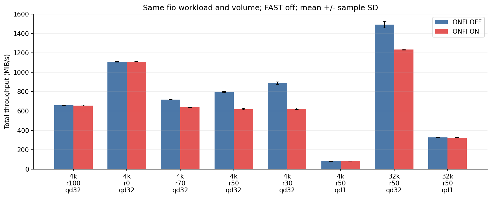
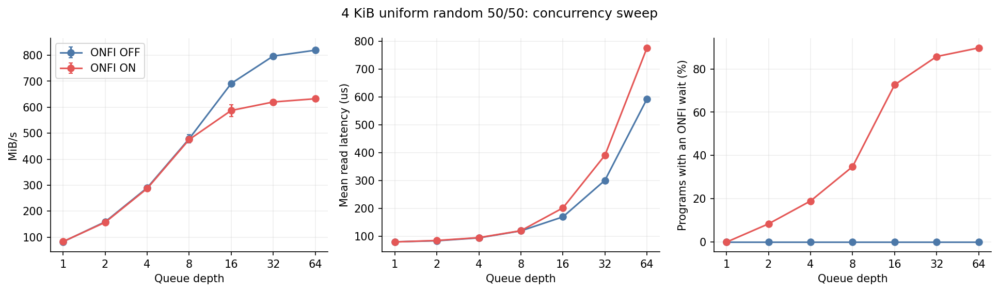
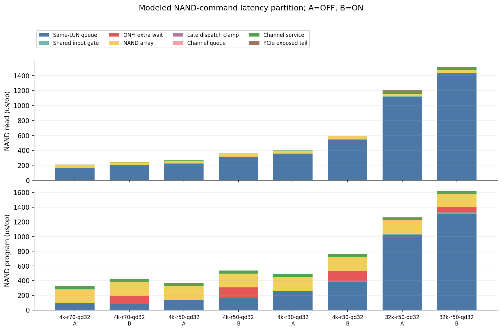
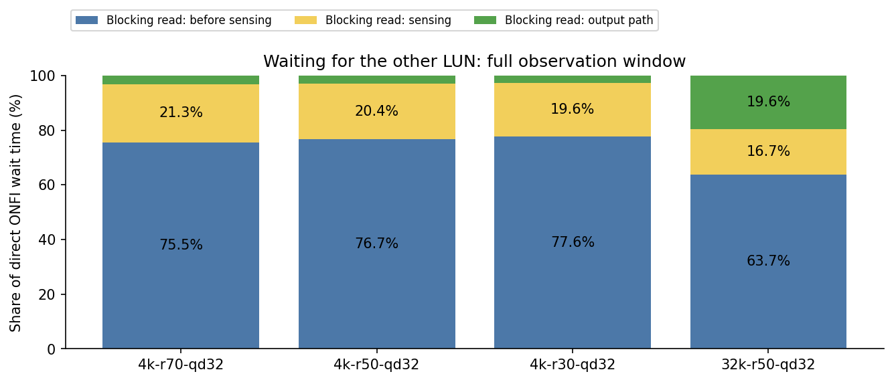
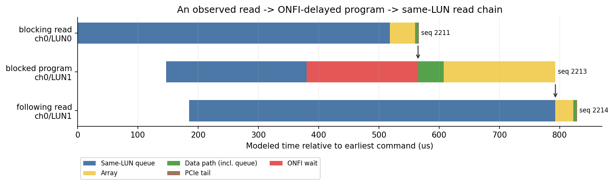

# ONFI 实验图表

[详细报告与完整表格](SUMMARY.md)。图中 A/B 两组均关闭 FAST。

原八种配置的总吞吐，误差线为三次独立重建的样本标准差。

[可缩放 SVG](throughput.svg)

4 KiB、读写各半的队列深度扫描：吞吐、读平均延迟、program 触发 ONFI 的比例。

[可缩放 SVG](qd_sweep.svg)

每条 NAND 命令的平均模型时延分解，A=ONFI关、B=ONFI开；不是应用墙钟时间分摊。

[可缩放 SVG](nand_breakdown.svg)

直接 ONFI 等待内部的完整时间划分，使用全量计数，而非采样窗口。

[可缩放 SVG](onfi_wait_composition.svg)

真实随机 fio 中捕获的阻塞链。数据阶段将通道传输与排队合并展示；箭头顺序由命令序号和依赖关联确认。

[可缩放 SVG](blocking_chain.svg)
